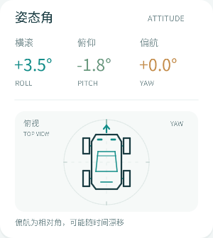
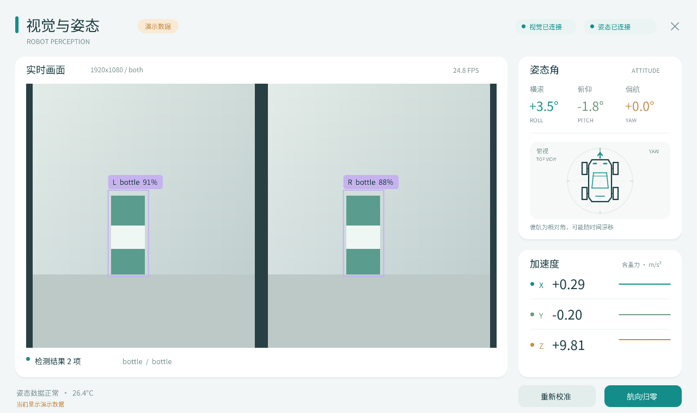

# YOLO 与 IMU 统一窗口 · RK3588 / Buildroot

> 2026-10-15 · 俯视小车动画＋默认全屏 v3 · ACG138 · 双目 OV5640 · MPU9250 · Weston / Wayland

## 🚗 v3 俯视小车与全屏升级

右侧原水平仪替换为简约四轮小车俯视图。车头带方向箭头，随相对 Yaw 旋转：归零后朝上，正角向左、负角向右；横滚和俯仰保留上方数值，不再倾斜动画视角。IMU 数据无效或超时时灰显并提示等待。圆环顶部是相对零方向，不表示磁北。

启动后默认请求全屏，按屏幕尺寸等比例显示，顶部右侧关闭按钮仍可退出。直接执行原来的 `./run-perception.sh` 即可，不必追加全屏参数；需要普通可拖动窗口时使用 `./run-perception.sh --windowed`。`--demo` 也默认全屏，并可演示小车航向变化。

已经运行 v2 的板子仅需替换窗口二进制。把 `perception-dashboard-top-view-arm64-v3-20261015.tar.gz` 复制到 `/root/`，先关闭旧窗口，再执行：

```sh
cd /root
tar -xzf perception-dashboard-top-view-arm64-v3-20261015.tar.gz
cd /root/perception-dashboard
cp -p perception-dashboard.aarch64 perception-dashboard.aarch64.bak
cp /root/perception-dashboard-top-view-update/perception-dashboard.aarch64 perception-dashboard.aarch64.new
chmod +x perception-dashboard.aarch64.new
mv -f perception-dashboard.aarch64.new perception-dashboard.aarch64
./run-perception.sh
```

若原窗口放在其他目录，将 `/root/perception-dashboard` 换成实际目录。必须更新启动器优先使用的项目根目录 `perception-dashboard.aarch64`，只更新 `build/` 下文件不会覆盖根目录的旧版本。原来的模型、运行库、启动参数可以沿用。



本次严格编译、ARM64 交叉编译、原有单元检查和 Wayland 窗口检查已通过；检查了默认全屏请求、窗口模式回退，以及 0°、+90°、-90°、180° 和超时状态的原生渲染。本环境未连接实际 RK3588 屏幕。

## 🖥️ 在板上运行

先退出原来的 `yolo` 程序，释放摄像头。将发布包放到 RK3588 可写目录，在原先能够接收 IMU 的 root 终端执行：

```sh
tar -xzf perception-dashboard-buildroot-arm64-v2-20261015.tar.gz
cd perception-dashboard
./run-perception.sh
```

发布包已带当前工作区的 `YOLO/model.rknn` 和 COCO 80 类标签作为备用。不需要在板上装 Python、Qt、OpenCV 或 GStreamer。新版启动器优先复用你现有的 `/root/rknn_yolov8_demo/model/yolov8s.rknn` 及同目录标签，并把 `/root/rknn_yolov8_demo/lib` 加入动态库搜索路径。

根据你提供的 `/root/run-yolo.sh` 和运行日志，本版已适配以下启动条件：

| 项目 | 新版启动器的行为 |
|---|---|
| 摄像头 | 使用 `/root/find-video.sh` 自动查找，当前实测节点为 `/dev/video41`，重新准备 ISP 后再次查找 |
| ISP | 没有 `isp-probe` 时，以 `ISP_DISPLAY=0` 调用 `/opt/fpga-camera-isp-1080/run_isp_camera.sh dual-1080 100000` |
| 就绪检查 | 最多等待 30 次，确认摄像头节点返回 NV12；失败说明原因，不使用未就绪的图像 |
| 桌面 | 优先沿用当前会话，自动查找时包含 `/run`；默认 `/run/wayland-0` |
| 模型/运行库 | 优先复用原 YOLO 已跑通的模型、标签和 `lib` 目录 |

ISP 日志为 `/tmp/perception-isp.log`。本程序关闭后 ISP 采集服务按原方案保留。先退出旧的 YOLO 检测窗口，以免两个检测程序争用同一个输出节点。

可以显式指定你当前的设备和原 IMU 接口：

```sh
./run-perception.sh --camera /dev/video41 --interface eth1
```

`eth1` 只是示例，请使用原来接收 IMU 成功的接口；省略时沿用自动识别。错误设备不会被当成有效图像推理。启动准备失败时终端报错退出；窗口打开后的视觉处理错误会保留 IMU 显示。IMU 原始以太网接收需要 root 或 CAP_NET_RAW。

若从串口/SSH 启动且桌面连接失败，使用实际 Weston 会话，例如：

```sh
XDG_RUNTIME_DIR=/run WAYLAND_DISPLAY=wayland-0 ./run-perception.sh
./run-perception.sh --fullscreen
./run-perception.sh --demo
```

`--demo`、`--preview`、`--help` 跳过摄像头发现、ISP 启动和就绪等待。演示数据有明确标记，不调用摄像头、NPU 或原始网络。原有 `yolo` 命令保留；新版连接现有 Weston，不另启桌面。

需要手动管理 ISP 或连接其他相机时，可使用 `PERCEPTION_PREPARE_ISP=0 ./run-perception.sh --camera /dev/videoN`。`MODEL_PATH`、`LABELS_PATH`、`CAMERA_DEVICE` 可设置默认资源；显式命令行参数优先。板端目录变化可通过 `YOLO_DIR`、`FIND_VIDEO_SCRIPT`、`ISP_CAMERA_SCRIPT` 覆盖。

## 📊 一个窗口中的内容

- 左侧：双目视频、L/R 检测框、类别、置信度和当前显示处理速率。
- 右侧：横滚 Roll、俯仰 Pitch、相对偏航 Yaw、俯视线条小车航向动画、三轴加速度和短时趋势。
- 底部：静态零偏校准、航向归零。启动后保持 IMU 静止约 2 秒。
- 摄像头超过 1 秒没有新图像，停止显示实时检测框；IMU 超过 500ms 没有有效新六轴采样，数值显示横线。

左右眼分别检测，因此“检测结果 N 项”是两眼检测结果总数，**不是立体匹配后的独立物体数量**。两只眼看到同一个瓶子时出现两个框是正常的。

沿用已工作的 IMU9 原始以太网协议和四元数融合。加速度包含重力，单位 m/s²；Yaw 是相对角，会漂移，不是磁北航向。未把未经磁力计校准的数据用于强制校正偏航。校准和航向归零只影响显示解算。



## 🔧 本次针对识别问题的修改

| 原代码中确认的问题 | 本版处理 |
|---|---|
| 双目合成的 1920×1080 整体缩到 640×640，每只眼只剩约 320×360 的有效画面 | 默认左右 960×1080 分别等比例补边到模型尺寸；640 模型约为每眼 569×640，有效细节更多 |
| 固定使用请求尺寸与紧密 NV12 排列，忽略驱动协商结果 | 使用实际宽高、像素格式、行跨度、平面数、缓冲长度和颜色元数据 |
| 取帧重试超时后仍可能使用未取到的缓冲区 | 明确处理超时、EAGAIN、EINTR、错误帧和截断帧，不产生假图像 |
| NV12→RGB 失败后依然推理，CPU fallback 又不支持该转换 | 自带有边界检查的 NV12/NV21/YUYV/RGB/BGR 转换，失败即停止本次视觉处理 |
| 框去除 padding 后仍按模型尺寸裁剪 | 使用实际缩放比例映射回单眼原图，按 ROI 边界裁剪，再映射至显示画面 |
| 推理、显示、逐框日志和每 30 帧自动写 PNG 串在一起 | 推理独立线程、及时归还相机缓冲、取最新可用帧、复用内存，默认不保存图片 |
| 没有检查模型输出是否与解码器相符 | 初始化验证 Rockchip YOLOv8 的 6/9 路 DFL/分类输出；不兼容模型明确报错 |

分类头本来已经做过 sigmoid，本版不重复 sigmoid。DFL 使用稳定 softmax，NMS 按类别并在每个物理相机内分别执行。帧图像和它的框一起发布给窗口，避免把旧框画到另一帧上。

## 🎯 是否更新 YOLO 模型

先用本版沿用现有 YOLOv8s 模型，修正输入与坐标问题，再用实际拍摄的同一批图片比较。当前 `YOLO/convert.py` 明确使用 `do_quantization=False`；不能把原来的识别不准直接归因于 INT8 量化。

本次没有训练或更换模型权重，也没有你实际场景的标注验证集，**不能给出准确率提升百分比**。现有 COCO 模型只能识别其类别表里的类别；要识别特定竞赛物品，应按实际左右摄像头图像标注、微调并保留独立验证集，比较漏检、误检和框位置。换一个更新版本并不替代这一步。

可比较以下模式，左右模式仍显示整个双目画面，但只在指定眼上推理：

```sh
./run-perception.sh --view both       # 默认：两眼分别推理，工作量约两次推理
./run-perception.sh --view left       # 只识别左眼，通常更快
./run-perception.sh --view right      # 只识别右眼
./run-perception.sh --view single     # 输入本身是单目图，整个画面推理
```

置信度默认 0.35，比旧程序 0.25 更严格：低分误报会减少，也可能增加漏检。可调整比较，不代表模型本身变准：

```sh
./run-perception.sh --confidence 0.25
./run-perception.sh --confidence 0.45 --nms 0.45
```

后续替换模型使用 `--model` 和匹配顺序的 `--labels`。仅支持与当前 Rockchip YOLOv8 分支结构兼容的静态输入检测模型；标准单输出 `[1,84,8400]` ONNX、YOLO11/26、分割/姿态模型不能仅改文件名直接运行。转换前可用 `tools/convert_rknn.py` 在开发机检查并转换兼容 ONNX；它不会训练模型。

## 🛠️ 构建与运行库

预编译程序为 ARM64 glibc ELF，自身最高需要 **GLIBC_2.33**。依赖 `libwayland-client.so.0`、`librknnrt.so`、`libdl.so.2`、`libm.so.6`、`libpthread.so.0`、`libc.so.6`；RKNN 库还依赖板上的 C++ 运行库。必须使用与板上 NPU 驱动匹配的 RKNN 运行库。没有打包开发机的共享库。

启动器已自动加入 `/root/rknn_yolov8_demo/lib`；若旧 YOLO 移到了其他目录，设置 `YOLO_DIR` 或 `LD_LIBRARY_PATH`。不要用其他系统的 libc/Wayland 覆盖板上的库。glibc 过旧需用匹配的 Buildroot SDK 重编译。

开发机可构建窗口演示、运行单元测试和无屏幕窗口协议测试：

```sh
make
make test
make test-window
make test-launcher
./build/perception-dashboard --demo
```

主机默认不链接 ARM64 RKNN；真实推理会明确提示当前构建没有 RKNN 支持。开发机有相应 Python 依赖与本地 ONNX 时可运行 `make test-onnx`，这是离线模型链路检查，不调用 NPU。

工作区内交叉编译：

```sh
./scripts/build-arm64.sh
```

其他 SDK 通过 `CROSS_COMPILE`、`WAYLAND_INCLUDE`、`WAYLAND_LIB`、`RKNN_INCLUDE`、`RKNN_LIB` 指定路径。在 ARM64 板上已安装开发头文件时可使用 `make RKNN=1`。本程序要求线性 NV12/NV21（单/双内存平面）、YUYV、RGB24 或 BGR24 的 V4L2 streaming 采集；不将 MJPEG、压缩或 tiled 图像冒充 RGB。

## ✅ 验证范围

严格 C/C++ 编译；IMU 协议、姿态、校准、去重、超时；图像格式/stride/颜色/截断；DFL、模型结构、补边、坐标还原、类别 NMS 和非法数值；窗口配置、双缓冲、帧回调、缩放、关闭；ARM64 构建和动态依赖已检查。详情见 `reports/build_and_tests.log`。

v2 仅更新启动器及部署说明，原生窗口和推理 ELF 的 SHA256 保持 `c5257290a5239ccc038b5b0f4de143e6644f614032b939a2441c710a4f78c1b8`。模拟启动测试覆盖 ISP 复用/启动、动态发现、NV12 等待/超时、库路径、参数优先级和演示跳过；不会调用实物 ISP。测试记录见 `reports/launcher_tests_v2.log`。

**尚未连接你的 RK3588 实测摄像头、NPU、IMU 网络和屏幕，也没有实际场景精度评测。** 示例预览中的瓶子和数值是演示数据。

参考：[Rockchip YOLOv8 部署说明](https://github.com/airockchip/rknn_model_zoo/blob/main/examples/yolov8/README.md)、[Linux V4L2 行跨度与格式](https://cdn.kernel.org/doc/html/latest/userspace-api/media/v4l/pixfmt-v4l2.html)、[Ultralytics 模型验证说明](https://docs.ultralytics.com/modes/val)。字体许可证见 `assets/FONT-LICENSE`，Wayland 协议源码保留原许可证。
