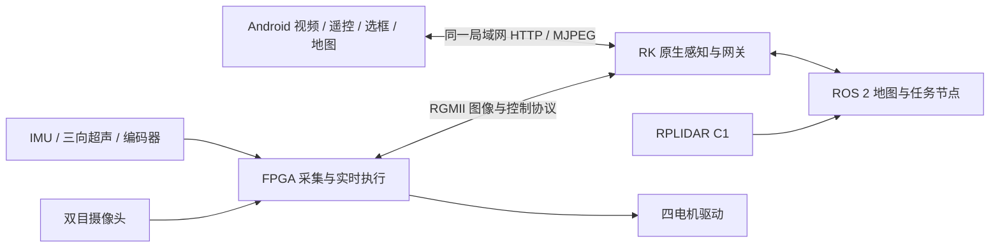

# 基于 FPGA 与 RK3588 的具身智能移动机器人

**源码基线：FPGA v54（150/70 mm）、RK v143、Android 1.2.43（versionCode 56）。**  
**文档日期：2026-11-04。** 本文描述当前源码和已保存的验证结果；“实现”表示代码存在，“静态验证”表示主机/板端空闲状态核对，“待验收”表示尚无该最终组合的实车通过记录。

## 1. 项目目标与应用

项目面向移动巡检与人机交互，将视觉识别、多传感采集、手动驾驶、地图导航和目标跟随整合到 FPGA + RK3588 平台。手机提供视频、选框、地图和任务操作入口；RK 完成视觉推理与任务协调；FPGA 完成低延迟采集、运动协议解析、软核规划及电机输出。用于展示异构计算协同与完整工程实现，具体比赛任务和评分以官方指南为准。

当前代码支持人员/物体及 PPE 类别识别、违规截图/播报的配套逻辑、雷达建图与地图操作、目标导航、语义目标搜索、视觉选框和前超声波目标跟随。功能存在不等于所有场景已经完成实车验收；各项状态见第 6 节。

## 2. 系统组成与数据流

| 平台 | 主要输入 | 主要处理 | 输出/接口 |
| --- | --- | --- | --- |
| GW5AT-LV60PG484AC1/I0 FPGA | 双目摄像头、IMU、三向超声波、四轮编码器、RK 控制/地图 | 图像链、跨时钟域传输、协议校验、RISC-V 软核 A* 与路径执行、超声避障、电机保护 | RGMII 图像/状态、规划/执行状态、四电机 PWM |
| RK3588 / Linux 6.1.75 | FPGA 图像/状态、RPLIDAR C1、手机请求 | 原生 C/C++ 感知与 HTTP 网关；RKNN 推理；Ubuntu 24.04 ARM64 chroot 中 ROS 2 Jazzy 节点 | 手机视频/JSON、地图、任务状态、FPGA 控制与许可 |
| Android | HTTP/MJPEG、检测元数据、地图与车辆状态 | 连接/指令租期、选框身份、UI/摇杆、截图归档、导航/搜索/跟随操作 | 人工命令与目标选择 |

RK 原生环境与 ROS 用户空间分开：宿主运行摄像头/感知/网关，ROS 位于 `/acg138-ros2/rootfs`。主入口 `deploy/run-stack.sh` 负责本次会话的子进程与锁；ROS 入口按基础、exploration、semantic_20261103 的覆盖顺序装载。开机/服务启动保持空闲，需要用户明确使能及启动任务。

## 3. FPGA 最终源码

最终源码见 [fpga/v54_150_70_20261104](fpga/v54_150_70_20261104/README.md)，来源为指定 `robot_navigation_v54_obstacle_reverse.fs` 的冻结构建工程。内部工程名仍为 `robot_navigation_v42_singlemap`，顶层 `robot_fmc_remote_top`；v42 字样不表示当前回退到 v42。

主要部分包括摄像头采集与预处理、以太网传输、IMU/SNS 状态、编码器、三向超声波、控制权/序号/许可检查、PicoRV32 RV32IM 软核、局部网格 A* 与路径执行。`common/` 是跨平台协议源码，`softcore/firmware/` 是软核 C 固件。

v54 的最终变更保留 **150 mm 避障基准**，前超声小于 **70 mm** 触发独立后退，后退持续到前方达到 **150 mm** 停止；既有转向及随后前进 **300 mm** 再规划的链路保留。该行为属于 FPGA 自主导航执行，不应与 RK 跟随的 0.3 m 保持距离混用。RK 跟随因无后方超声覆盖而不自动倒车。

已有冻结工具记录：布局布线完成、未布通 0、setup/hold 违例 0/0、最差 setup 余量约 **+0.001 ns**，原 CST/SDC 未放宽。这个记录只表示该冻结实现的工具检查通过，裕量很小；本次源码整理未重新跑 Gowin，也未烧录最终 v54 或完成该版实车验收。工具版本/器件、输入约束及 SDK 应保持匹配，重新构建不能保证相同位流哈希或相同物理结果。

## 4. RK3588 最终功能

### 4.1 视觉与视频

`robot-fpga-integration-20261102/perception/` 实现双目输入、RKNN 目标识别、检测框跟踪/连续性、视频编码与 HTTP/MJPEG 服务。UI 绘框的连续显示与跟随所用的观测新鲜度分别管理；短暂漏检不会因为刷新 ID 立即丢掉选框，旧框也不能冒充新鲜观测继续驱车。目标丢失不应终止独立的视频传输。帧率、延迟和检测准确率依赖模型、BSP 与场景；本材料不提供未经本版实测的统一性能指标。

### 4.2 当前跟随：视觉定方向、前超声定距离

操作流程：连接手机 → 查看视频 → 选择检测目标 → 明确使能/点击跟随。车辆先按目标在画面的水平偏差转向，目标居中后依据前超声波靠近。

| 条件 | 当前预期行为 |
| --- | --- |
| 目标居中、前超声有效且大于 0.35 m | 低速前进，接近约 0.30 m |
| 前超声在 0.25–0.35 m（含边界） | 静止保持 |
| 前超声小于 0.25 m | 停车，等待目标离开；不自动后退 |
| 目标在画面左/右偏离 | 先转向对准；对应侧超声近障时停车 |
| 未收到匹配雷达点/雷达位姿 | 不作为本跟随模式的距离与转向前置条件 |
| 短暂漏检、超声/IMU/指令不新鲜 | 输出零速并按状态等待或退出，视频通道独立维持 |
| 用户取消、停止或失能 | 撤销任务/运动许可；传感器恢复不能自动重启 |

源码限速配置为前进约 **0.16 m/s**、转向约 **0.35 rad/s**；它们是软件命令上限，不是测得的车辆速度。没有后方超声波，本跟随模式不倒车。前超声波的回波不能识别目标身份，因此当前使用前提是选中目标位于前超声覆盖区；背景/其他近物体可能被量到。该模式不要求摄像头内参进行雷达投影，也不声称通过单目图像计算出了精确三维距离。

相关实现：`perception/phone/controller.{h,cc}`、`phone_service.cc`、`follow_sensors.h`；ROS 配套位于 `ros2/acg138_semantic_20261103/src/acg138_semantic/`。

### 4.3 地图、导航与语义任务

基础 ROS 包提供雷达扫描、编码器里程计与 TF；探索层提供过滤、地图/路径与任务生命周期；语义层提供语义目标、跟随配套及搜索状态。手机具备手动建图、保存/载入、选点和操作反馈的代码路径，FPGA 负责其协议下的规划/执行。

语义搜索的当前代码可将既有中文目标/PPE 类别连接到新鲜 YOLO 结果与移动策略；其无地图短段搜索使用雷达净空和里程计，不等同于任意环境的完备搜索算法。**“跟随不依赖雷达”只适用于前超声波跟随模式**，不表示已经去除了建图/导航/语义搜索中的雷达依赖。

语音/PPE 模块保留源码、配置和播放器脚本；模型、实际音频文件及相关运行库依赖原部署环境。源码中保留的 SmolVLM/RKLLM 语义服务属于配套模式，不能据此宣称与 YOLO 同时满速运行已通过验收。

## 5. Android 最终功能

当前包名 `cn.acg138.robotphone`，`versionName=1.2.43`、`versionCode=56`。Java + 原生 Android 资源构建，不需要 Gradle 在线下载；入口为 `build-apk.sh`。

包括无线连接/配对、前台租期、使能与停机、摇杆、MJPEG 视频、识别框选择、跟随反馈、地图/目标/轨迹、语义任务和截图存储逻辑。视频重连与控制状态分离；过期 HTTP 响应不能覆盖新的选择。构建脚本要求提供已有签名文件，仓库不保存签名私钥或运行令牌。源码已具备构建和主机测试记录；不能据此认定本版 APK 已在用户手机覆盖安装。

## 6. 当前验证与交付状态

| 项目 | 已有依据 | 实际边界 |
| --- | --- | --- |
| v54 FPGA | 冻结输入校验、工具时序记录、既有仿真记录 | 尚无最终 v54 烧录/地面运行验收；本次不重新综合 |
| RK 原生主程序 | 串口读取 SHA-256，与本地 v143 编译记录匹配 | 板上未保留该原生 C/C++ 源码，由匹配的本地源码补齐 |
| RK 网关 | 板端 SHA-256 与历史安装记录及构建源文件哈希匹配 | 本次不重新安装运行程序 |
| RK ROS/启动脚本 | 串口检查、局域网导出、逐文件哈希核对 | 保留源文件，不包含 install、rootfs 或系统库 |
| Android v143 | manifest/源码身份、既有构建和主机测试 | 手机实装和最终组合动态操作待验收 |
| 本次仓库整理 | 清单校验、输出/密钥检查、干净副本主机回归 | 不替代真实制动距离、跟随、避障、建图和任务测试 |

身份参考（仅记录，二进制不入库）：

- v54 `.fs`：`8d14112174a40799b2a9299ccb88c2d0b20a4f70ec397b89b1c8a189a11c860e`
- RK v143 主程序：`fda5e667966ba85b775f3829bdaedfe2a5d5c985e852c1443505f9c813151189`
- RK 已安装网关：`1f9ac2dafcb3511e06798b011af3ba95da7d188e7837b6813bddb8e350592cc7`

## 7. 工程价值与提交材料范围

工程特点是把传感器、视觉、规划执行、无线 UI 和权限/时效状态连接为可追溯的多平台代码体系。RTL、软核 C、原生 C/C++、ROS Python/C++ 与 Android Java 均可直接审阅，历史快照保留版本演进。

本仓库作为比赛的**源码与项目技术说明材料**。完整系统演示、硬件接线核验、实测性能表、视频、官方报名表及现场验收记录需与源码版本对应另行提供。既有旧报告不作为当前全系统完成证明。构建依赖见 [构建与复现](文档/构建与复现.md)，执行边界见 [验证与验收](文档/验证与验收.md)。
